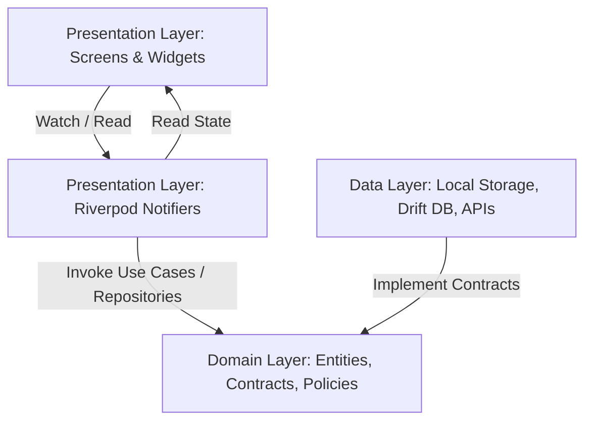
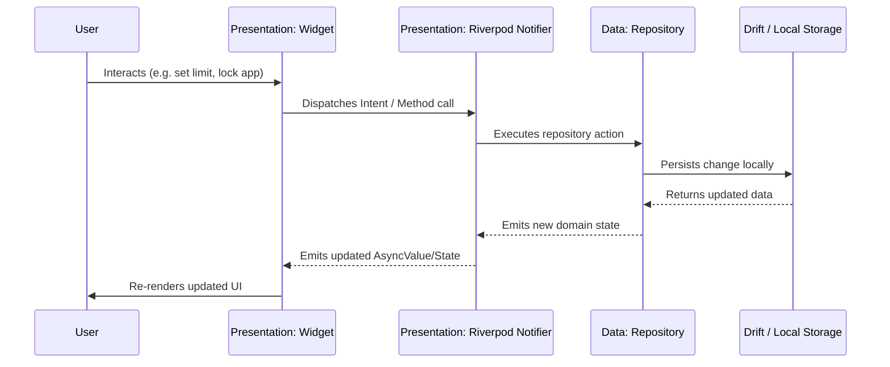

# ZeroScroll — System Architecture & Technical Specification

## 1. Architectural Overview & Philosophy

**ZeroScroll** is an Android-first Flutter application engineered with one strict objective: providing a focused, distraction-free interface displaying **ONLY** the Direct Messages and Notifications/Activity sections of the user's account inside a guarded WebView container.

All algorithmic discovery mechanisms—including the Home Feed, Explore/Search tab, Reels feed, Stories tray, and external profile browsing—are structurally prevented, filtered, or blocked.

### Core Non-Negotiable Tenets
1. **Zero External Backend & Absolute Privacy:**
   - No app-specific backend exists.
   - All session data, authentication state, cookies, usernames, message bodies, and notification details remain strictly on-device in secure storage and Drift SQLite.
   - Zero analytics, crash reporting, or telemetry SDKs are bundled.
2. **Deterministic Flavor Isolation:**
   - Two distinct distribution flavors: `play` and `sideload`.
   - Any self-updating code and permissions (`REQUEST_INSTALL_PACKAGES`) are strictly isolated to the `sideload` flavor and omitted from `play`.
3. **Resilient DOM Selectors:**
   - No hardcoded dynamic or obfuscated CSS classes.
   - Selectors rely on semantic attributes (`href`, `aria-label`, `role`) and externalized remote configuration so updates never require breaking binary patches.

---

## 2. Directory & Layer Organization

The project follows a **Feature-First Clean Architecture**:

```
ZeroScroll/
├── android/
│   └── app/
│       ├── build.gradle.kts                      # Gradle build config with play & sideload flavors
│       ├── proguard-rules.pro                   # R8/ProGuard shrinking & obfuscation rules
│       └── src/
│           ├── main/
│           │   ├── AndroidManifest.xml          # Base Android manifest (INTERNET, ACCESS_NETWORK_STATE)
│           │   └── kotlin/com/apexventures/zeroscroll/MainActivity.kt
│           ├── play/
│           │   └── AndroidManifest.xml          # Play store manifest (no updater permissions)
│           └── sideload/
│               └── AndroidManifest.xml          # Sideload manifest (REQUEST_INSTALL_PACKAGES)
├── lib/
│   ├── main.dart                                # Universal Flutter entrypoint
│   ├── main_play.dart                           # Dedicated Play flavor entrypoint
│   ├── main_sideload.dart                       # Dedicated Sideload flavor entrypoint
│   ├── core/
│   │   ├── config/                              # AppFlavor & FlavorConfig providers
│   │   ├── constants/                           # AppConstants (IDs, URLs, SDK versions)
│   │   ├── database/                            # Drift SQLite database definition
│   │   ├── router/                              # GoRouter declarative navigation
│   │   └── theme/                               # Material 3 light and dark theme definitions
│   └── features/
│       ├── webview/                             # Guarded WebView orchestration & content injection
│       ├── shell/                               # Root navigation scaffold & bottom destination bar
│       ├── notifications/                       # In-app notifications & account activity
│       ├── limits/                              # Session tracking & daily usage limits
│       ├── settings/                            # User preferences & customization
│       ├── onboarding/                          # Privacy manifesto & initial walkthrough
│       ├── remote_config/                       # Remote selector rules & security patterns
│       ├── security/                            # Biometric authentication (local_auth)
│       └── updater/                             # Sideload in-app APK updater
├── test/                                        # Unit & widget tests
└── docs/
    └── ARCHITECTURE.md                          # This architecture specification
```

---

## 3. The Layered Structure

Each feature inside `lib/features/<feature>/` adheres to the following three layers:



### 3.1 Domain Layer (`domain/`)
- Contains pure Dart business entities, value objects, and repository interfaces.
- Completely free of external framework dependencies (Flutter widgets, HTTP clients, Drift implementations).
- Defines contracts that describe what operations are possible without specifying how they are implemented.

### 3.2 Data Layer (`data/`)
- Implements the repository interfaces defined in the domain layer.
- Handles interactions with low-level data sources:
  - Drift (SQLite) database for persistent state and usage metrics.
  - `SharedPreferences` for user preferences and feature flags.
  - Native platform channels (via `local_auth` and `flutter_inappwebview`).
  - Read-only HTTPS client for remote config and version checks.

### 3.3 Presentation Layer (`presentation/`)
- Built entirely using Riverpod (`StateNotifierProvider`, `FutureProvider`, `Provider`).
- Implements Material 3 responsive UI components.
- Reacts directly to immutable state changes without managing imperative widget state.

---

## 4. Unidirectional Data Flow

The app enforces a strict unidirectional reactive data flow:



---

## 5. Feature Map & Responsibilities

| Feature | Responsibility | Key Components |
| :--- | :--- | :--- |
| **`webview`** | Displays the guarded web container; injects CSS/JS rules; intercepts URLs; restricts media viewer to one item at a time. | `WebviewMode`, `WebviewRepository`, `webviewNotifierProvider` |
| **`shell`** | Manages the root scaffold, bottom navigation, and top bar; exposes flavor badges. | `ShellTab`, `ShellRepository`, `HomeScreen`, `activeShellTabProvider` |
| **`notifications`** | Aggregates and displays account notifications and message alerts in-app. | `NotificationItem`, `NotificationsRepository`, `notificationsListProvider` |
| **`limits`** | Tracks daily screen time inside messages and alerts user when limits are reached. | `UsageLimit`, `LimitsRepository`, `limitsProvider` |
| **`settings`** | Manages theme mode, biometric locks, clearing cache, and developer inspection info. | `AppSettings`, `SettingsRepository`, `settingsNotifierProvider` |
| **`onboarding`** | Introduces the app's privacy-first posture and guides the user through setup. | `OnboardingPageData`, `OnboardingRepository`, `onboardingStateProvider` |
| **`remote_config`** | Fetches and caches remote route rules and DOM selectors without app binary updates. | `RemoteConfigModel`, `RemoteConfigRepository`, `remoteConfigProvider` |
| **`security`** | Manages app-level biometric unlocking via `local_auth` and prevents unauthorized access. | `SecurityStatus`, `SecurityRepository`, `securityProvider` |
| **`updater`** | Checks for APK updates and prompts installations (strictly active on `sideload` flavor). | `UpdateInfo`, `UpdaterRepository`, `updateCheckProvider` |

---

## 6. Build Flavor Isolation

| Dimension | Play Store Flavor (`play`) | Sideload Flavor (`sideload`) |
| :--- | :--- | :--- |
| **Application ID** | `com.apexventures.zeroscroll` | `com.apexventures.zeroscroll` |
| **App Title** | `ZeroScroll` | `ZeroScroll (Sideload)` |
| **Updater Code** | Disabled (returns `null` safely) | Enabled (reads `version.json`, downloads APK) |
| **Permissions** | `INTERNET`, `ACCESS_NETWORK_STATE` | `INTERNET`, `ACCESS_NETWORK_STATE`, `REQUEST_INSTALL_PACKAGES` |
| **Launch Entrypoint** | `lib/main_play.dart` | `lib/main_sideload.dart` |
| **CLI Run Command** | `flutter run --flavor play -t lib/main_play.dart` | `flutter run --flavor sideload -t lib/main_sideload.dart` |

---

## 7. Verification & Continuous Integration (CI)

Every commit and pull request must execute:
1. `flutter analyze` — Enforces strict Dart linting rules with zero warnings.
2. `flutter test` — Runs all unit and widget tests across domain logic, providers, and presentation.
3. R8 code shrinking and optimization checks during release builds.
